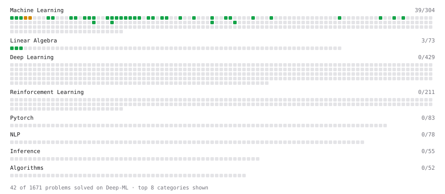

# Deep-ML

My machine learning practice from [Deep-ML](https://www.deep-ml.com). Every solution here was written by hand.

**59** solved · 50 problems · 0 labs · 9 math

[**Browse the interactive portfolio**](https://yuxinyang95.github.io/deep-ml/) to replay this filling in over time.

## Problems

| | Difficulty | Solved | |
| --- | --- | --- | --- |
| [Batch Iterator for Dataset](https://www.deep-ml.com/problems/30) | easy | 2026-04-07 | [solution](problems/0030-batch-iterator-for-dataset) |
| [Binary Classification with Logistic Regression](https://www.deep-ml.com/problems/104) | easy | 2026-04-05 | [solution](problems/0104-binary-classification-with-logistic-regression) |
| [Calculate Accuracy Score](https://www.deep-ml.com/problems/36) | easy | 2026-04-07 | [solution](problems/0036-calculate-accuracy-score) |
| [Calculate Cosine Similarity Between Vectors](https://www.deep-ml.com/problems/76) | easy | 2026-10-01 | [solution](problems/0076-calculate-cosine-similarity-between-vectors) |
| [Calculate Dice Score for Classification](https://www.deep-ml.com/problems/73) | easy | 2026-04-12 | [solution](problems/0073-calculate-dice-score-for-classification) |
| [Calculate F1 Score from Predicted and True Labels](https://www.deep-ml.com/problems/91) | easy | 2026-04-12 | [solution](problems/0091-calculate-f1-score-from-predicted-and-true-labels) |
| [Calculate Jaccard Index for Binary Classification](https://www.deep-ml.com/problems/72) | easy | 2026-04-11 | [solution](problems/0072-calculate-jaccard-index-for-binary-classification) |
| [Calculate Mean Absolute Error (MAE)](https://www.deep-ml.com/problems/93) | easy | 2026-04-12 | [solution](problems/0093-calculate-mean-absolute-error-mae) |
| [Calculate R-squared for Regression Analysis](https://www.deep-ml.com/problems/69) | easy | 2026-04-11 | [solution](problems/0069-calculate-r-squared-for-regression-analysis) |
| [Calculate Root Mean Square Error (RMSE)](https://www.deep-ml.com/problems/71) | easy | 2026-04-11 | [solution](problems/0071-calculate-root-mean-square-error-rmse) |
| [Compute TTFT ITL and TPS from a Token Timestamp Stream](https://www.deep-ml.com/problems/411) | easy | 2026-04-14 | [solution](problems/0411-compute-ttft-itl-and-tps-from-a-token-timestamp-stream) |
| [Derivative of a Polynomial](https://www.deep-ml.com/problems/116) | easy | 2026-10-01 | [solution](problems/0116-derivative-of-a-polynomial) |
| [Detect Overfitting or Underfitting](https://www.deep-ml.com/problems/86) | easy | 2026-04-05 | [solution](problems/0086-detect-overfitting-or-underfitting) |
| [Dot Product Calculator](https://www.deep-ml.com/problems/83) | easy | 2026-10-01 | [solution](problems/0083-dot-product-calculator) |
| [Early Stopping Based on Validation Loss Plateau](https://www.deep-ml.com/problems/199) | easy | 2026-04-14 | [solution](problems/0199-early-stopping-based-on-validation-loss-plateau) |
| [ExponentialLR Learning Rate Scheduler](https://www.deep-ml.com/problems/154) | easy | 2026-04-14 | [solution](problems/0154-exponentiallr-learning-rate-scheduler) |
| [Feature Scaling Implementation](https://www.deep-ml.com/problems/16) | easy | 2026-04-07 | [solution](problems/0016-feature-scaling-implementation) |
| [Generate a Confusion Matrix for Binary Classification](https://www.deep-ml.com/problems/75) | easy | 2026-04-05 | [solution](problems/0075-generate-a-confusion-matrix-for-binary-classification) |
| [Gradient Checkpointing](https://www.deep-ml.com/problems/188) | easy | 2026-04-14 | [solution](problems/0188-gradient-checkpointing) |
| [Gradient Direction and Magnitude](https://www.deep-ml.com/problems/308) | easy | 2026-04-14 | [solution](problems/0308-gradient-direction-and-magnitude) |
| [Implement Early Stopping Based on Validation Loss](https://www.deep-ml.com/problems/135) | easy | 2026-04-12 | [solution](problems/0135-implement-early-stopping-based-on-validation-loss) |
| [Implement F-Score Calculation for Binary Classification](https://www.deep-ml.com/problems/61) | easy | 2026-04-07 | [solution](problems/0061-implement-f-score-calculation-for-binary-classification) |
| [Implement Gini Impurity Calculation for a Set of Classes](https://www.deep-ml.com/problems/64) | easy | 2026-04-11 | [solution](problems/0064-implement-gini-impurity-calculation-for-a-set-of-classes) |
| [Implement Hard Voting Classifier](https://www.deep-ml.com/problems/305) | easy | 2026-04-05 | [solution](problems/0305-implement-hard-voting-classifier) |
| [Implement Polynomial Kernel Function](https://www.deep-ml.com/problems/281) | easy | 2026-04-14 | [solution](problems/0281-implement-polynomial-kernel-function) |
| [Implement Precision Metric](https://www.deep-ml.com/problems/46) | easy | 2026-04-07 | [solution](problems/0046-implement-precision-metric) |
| [Implement Recall Metric in Binary Classification](https://www.deep-ml.com/problems/52) | easy | 2026-04-07 | [solution](problems/0052-implement-recall-metric-in-binary-classification) |
| [Implement Ridge Regression Loss Function](https://www.deep-ml.com/problems/43) | easy | 2026-04-07 | [solution](problems/0043-implement-ridge-regression-loss-function) |
| [Linear Kernel Function](https://www.deep-ml.com/problems/45) | easy | 2026-04-07 | [solution](problems/0045-linear-kernel-function) |
| [Linear Learning Rate Decay](https://www.deep-ml.com/problems/377) | easy | 2026-04-14 | [solution](problems/0377-linear-learning-rate-decay) |
| [Linear Regression Using Gradient Descent](https://www.deep-ml.com/problems/15) | easy | 2026-04-05 | [solution](problems/0015-linear-regression-using-gradient-descent) |
| [Linear Regression Using Normal Equation](https://www.deep-ml.com/problems/14) | easy | 2026-04-05 | [solution](problems/0014-linear-regression-using-normal-equation) |
| [Matrix-Vector Dot Product](https://www.deep-ml.com/problems/1) | easy | 2026-04-03 | [solution](problems/0001-matrix-vector-dot-product) |
| [Measure Disorder in Apple Colors](https://www.deep-ml.com/problems/108) | easy | 2026-04-12 | [solution](problems/0108-measure-disorder-in-apple-colors) |
| [One-Hot Encoding of Nominal Values](https://www.deep-ml.com/problems/34) | easy | 2026-04-07 | [solution](problems/0034-one-hot-encoding-of-nominal-values) |
| [Quality Filtering with Rejection Sampling](https://www.deep-ml.com/problems/508) | easy | 2026-04-14 | [solution](problems/0508-quality-filtering-with-rejection-sampling) |
| [Random Shuffle of Dataset](https://www.deep-ml.com/problems/29) | easy | 2026-04-07 | [solution](problems/0029-random-shuffle-of-dataset) |
| [Reshape Matrix](https://www.deep-ml.com/problems/3) | easy | 2026-04-03 | [solution](problems/0003-reshape-matrix) |
| [RL Training Experiment Tracking](https://www.deep-ml.com/problems/679) | easy | 2026-04-14 | [solution](problems/0679-rl-training-experiment-tracking) |
| [Scalar Multiplication of a Matrix](https://www.deep-ml.com/problems/5) | easy | 2026-10-01 | [solution](problems/0005-scalar-multiplication-of-a-matrix) |
| [Shift and Scale Array to Target Range](https://www.deep-ml.com/problems/141) | easy | 2026-04-12 | [solution](problems/0141-shift-and-scale-array-to-target-range) |
| [StepLR Learning Rate Scheduler](https://www.deep-ml.com/problems/153) | easy | 2026-04-14 | [solution](problems/0153-steplr-learning-rate-scheduler) |
| [Taylor Series Approximation](https://www.deep-ml.com/problems/310) | easy | 2026-04-14 | [solution](problems/0310-taylor-series-approximation) |
| [Transpose of a Matrix](https://www.deep-ml.com/problems/2) | easy | 2026-04-03 | [solution](problems/0002-transpose-of-a-matrix) |
| [Vector Element-wise Sum](https://www.deep-ml.com/problems/121) | easy | 2026-10-01 | [solution](problems/0121-vector-element-wise-sum) |
| [Vector Norms (L1/L2/L-inf) and the Frobenius Norm](https://www.deep-ml.com/problems/328) | easy | 2026-10-01 | [solution](problems/0328-vector-norms-l1-l2-l-inf-and-the-frobenius-norm) |
| [Implement K-Fold Cross-Validation](https://www.deep-ml.com/problems/18) | medium | 2026-04-15 | [solution](problems/0018-implement-k-fold-cross-validation) |
| [K-Means Clustering](https://www.deep-ml.com/problems/17) | medium | 2026-04-15 | [solution](problems/0017-k-means-clustering) |
| [Matrix times Matrix ](https://www.deep-ml.com/problems/9) | medium | 2026-10-01 | [solution](problems/0009-matrix-times-matrix) |
| [Quotient Rule for Derivatives](https://www.deep-ml.com/problems/312) | medium | 2026-10-01 | [solution](problems/0312-quotient-rule-for-derivatives) |

## Math

| | Difficulty | Solved | |
| --- | --- | --- | --- |
| [Derivatives and Gradients](https://www.deep-ml.com/math-problems/1) | easy | 2026-10-01 | [solution](math/0001-derivatives-and-gradients) |
| [Descriptive Statistics](https://www.deep-ml.com/math-problems/18) | easy | 2026-10-01 | [solution](math/0018-descriptive-statistics) |
| [Expectation and Variance Algebra](https://www.deep-ml.com/math-problems/33) | easy | 2026-10-01 | [solution](math/0033-expectation-and-variance-algebra) |
| [Gradient Descent Updates](https://www.deep-ml.com/math-problems/5) | easy | 2026-10-01 | [solution](math/0005-gradient-descent-updates) |
| [Matrix Basics](https://www.deep-ml.com/math-problems/9) | easy | 2026-10-01 | [solution](math/0009-matrix-basics) |
| [Probability Fundamentals](https://www.deep-ml.com/math-problems/19) | easy | 2026-10-01 | [solution](math/0019-probability-fundamentals) |
| [Vector Operations](https://www.deep-ml.com/math-problems/7) | easy | 2026-10-01 | [solution](math/0007-vector-operations) |
| [Matrix Multiplication](https://www.deep-ml.com/math-problems/10) | medium | 2026-10-01 | [solution](math/0010-matrix-multiplication) |
| [Vector Norms and Linear Independence](https://www.deep-ml.com/math-problems/8) | medium | 2026-10-01 | [solution](math/0008-vector-norms-and-linear-independence) |

---

_This file is regenerated by Deep-ML on every push._
